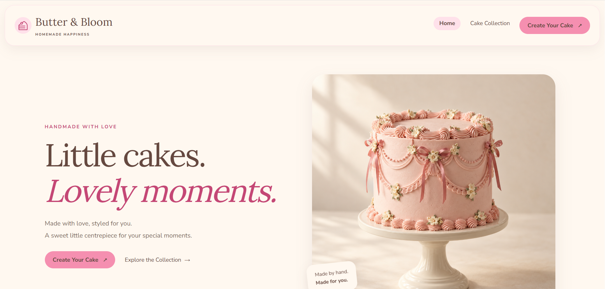
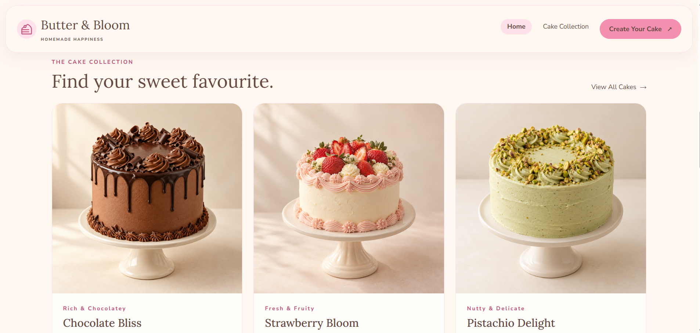
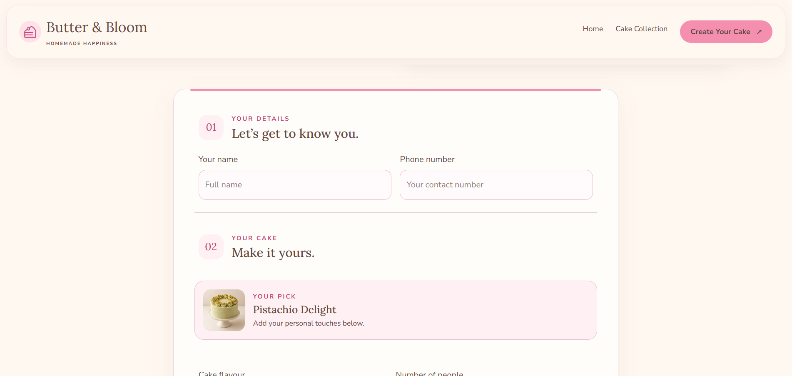
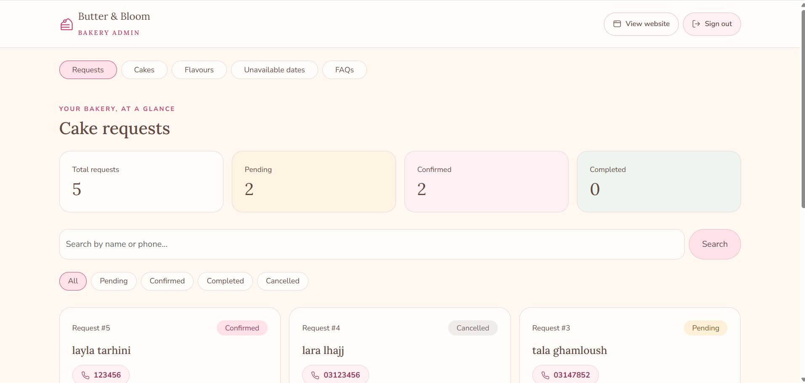
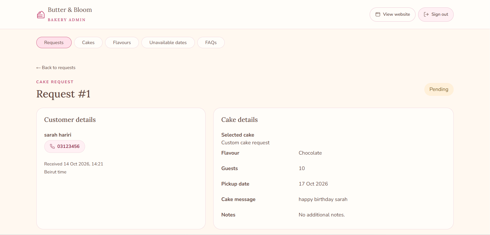

# Butter & Bloom 🍰

A responsive cake bakery website built with Laravel, Blade, Bootstrap and JavaScript.

Customers can explore the cake collection and submit personalised requests. The bakery owner manages cakes, flavours, requests, pickup availability and FAQs through a protected admin dashboard.


## Screenshots

### Home


### Cake Collection


### Custom Order


### Owner Dashboard


### Request Details


### Mobile

## Features

### Customer website
- Responsive cake collection and featured cakes.
- Cake layer assembly animation and subtle scroll effects.
- Selected cake and default flavour carried into the request form.
- Custom requests with guest count, pickup date, cake message and notes.
- Optional inspiration photo with preview and removal.
- Immediate feedback for unavailable pickup dates.
- Dynamic FAQs managed by the owner.

### Owner dashboard
- Password-only login for a single owner account.
- Login attempt throttling and protected admin routes.
- Request search, status filters and pagination.
- Request details and protected inspiration photos.
- Final pricing in USD.
- Pending, Confirmed, Completed and Cancelled statuses.
- Cake management with image uploads, ordering and visibility.
- Flavour management and featured cake selection.
- Pickup date blocking and unblocking.
- FAQ management.
- Confirmation dialogs for deleting cakes, flavours and FAQs.

## Technology

- Laravel 13
- PHP
- MySQL
- Blade components
- Bootstrap 5
- JavaScript
- GSAP
- SweetAlert2

## Requirements

- PHP 8.3 or newer, compatible with composer.lock
- Composer
- MySQL
- Required PHP extensions for Laravel and MySQL

The current interface uses assets directly from public/assets and CDN libraries. An npm build is not required for this setup.

## Local setup

### 1. Install PHP dependencies

```bash
composer install
```

### 2. Create your environment file

Copy `.env.example` to `.env`.

On Windows:

```powershell
Copy-Item .env.example .env
```

On macOS or Linux:

```bash
cp .env.example .env
```

### 3. Generate the application key

```bash
php artisan key:generate
```

### 4. Configure MySQL

Create a database named `butter_bloom` and update `.env`:

```dotenv
DB_CONNECTION=mysql
DB_HOST=127.0.0.1
DB_PORT=3306
DB_DATABASE=butter_bloom
DB_USERNAME=root
DB_PASSWORD=
```

Use your own database username and password where needed.

### 5. Create tables and load demo content

```bash
php artisan migrate
php artisan db:seed
php artisan storage:link
```

The demo seeder adds flavours, six cakes and three FAQs. It copies the included cake images into public storage.

It does not create customer requests or an owner account. Existing records with matching cake names, flavour names or questions are preserved.

### 6. Create the owner account

```bash
php artisan admin:create
```

Choose a password of at least 12 characters. Password input is hidden.

The same command can reset the existing owner password after confirmation. No default admin password is included.

### 7. Start the application

```bash
php artisan serve
```

Website: http://127.0.0.1:8000

Owner login: http://127.0.0.1:8000/admin/login

## Upload configuration

Uploads are limited to 5 MB by application validation.

PHP must also allow this size. For local development, check `php.ini`:

```ini
upload_max_filesize = 5M
post_max_size = 8M
```

Restart the PHP server after changing these settings.

## Order workflow

Submitting a request does not confirm an order.

The owner reviews the details, contacts the customer, agrees on the final price and updates the request status.

Status changes are recorded in the dashboard; they do not automatically send customer notifications.

Pickup is the only fulfilment option. Cake size is agreed with the customer based on the guest count.

## Privacy

- Environment secrets and local database exports are excluded from Git.
- Customer inspiration photos use private storage and protected admin routes.
- Catalogue photos use public storage.
- Customer requests and owner credentials are not included in demo data.

## Project scope

Butter & Bloom is a portfolio demonstration project. Production use requires deployment configuration, backups and further operational and security review.

Cake imagery is illustrative.

## Author

Sarah Hariri  
SWD — Smart Web Development